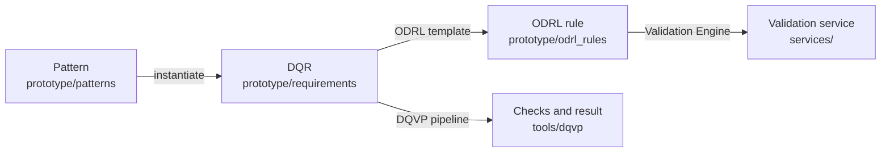

# Reference Catalog of Data Quality Requirement Patterns

The Reference catalog of Data Quality Requirement (DQR) Patterns supports Data Space Governance Authorities in defining and managing data quality in their data spaces. An authority elicits its DQRs by selecting patterns from the catalog and instantiating them, which yields a DQR catalog specific to its data space.

Each DQR then goes through three steps, and keeps its identifier through all of them:



## DQRs

| Pattern | DQR | Requirement | DQR record | ODRL rule | Validation service | Result |
| ------- | --- | ----------- | ---------- | --------- | ------------------ | ------ |
| [DQRP1](media/DQRP1/DQRP1-Currentness.png) Currentness | DQR7EH | Patient Summary records are at most 1,440 minutes old | [DQR7EH.json](prototype/requirements/DQR7EH.json) | [DQR7EH_odrl.json](prototype/odrl_rules/DQR7EH_odrl.json) | [policyChecker_05fb5861](services/policyChecker_05fb5861) | – |
| [DQRP1](media/DQRP1/DQRP1-Currentness.png) Currentness | DQR1LS | Live Stocks prices are at most 30 minutes old | – | [DQR1LS_odrl.json](prototype/odrl_rules/DQR1LS_odrl.json) | [policyChecker_69b7c656](services/policyChecker_69b7c656) | – |
| [DQRP2](media/DQRP2/DQRP2-Completeness.png) Completeness | DQR1EH | The national healthcare patient ID is always present | [DQR1EH.json](prototype/requirements/DQR1EH.json) | [DQR1EH_odrl.json](prototype/odrl_rules/DQR1EH_odrl.json) | [policyChecker_3ae130f1](services/policyChecker_3ae130f1) | 98.0% · violated |
| [DQRP2](media/DQRP2/DQRP2-Completeness.png) Completeness | DQR1HL | Every monitoring site has a location | [DQR1HL.json](prototype/requirements/heleade/DQR1HL.json) | [DQR1HL_odrl.json](prototype/odrl_rules/heleade/DQR1HL_odrl.json) | [heleade/DQR1HL](services/heleade/DQR1HL) | 100.0% · satisfied |
| [DQRP3](media/DQRP3/DQRP3-Compliance.png) Compliance | DQR2EH | The country of affiliation follows ISO 3166 | [DQR2EH.json](prototype/requirements/DQR2EH.json) | [DQR2EH_odrl.json](prototype/odrl_rules/DQR2EH_odrl.json) | [policyChecker_5b132606](services/policyChecker_5b132606) | 98.2% · violated |
| [DQRP3](media/DQRP3/DQRP3-Compliance.png) Compliance | DQR6EH | The hospital country follows ISO 3166 | [DQR6EH.json](prototype/requirements/DQR6EH.json) | [DQR6EH_odrl.json](prototype/odrl_rules/DQR6EH_odrl.json) | [policyChecker_32ec32b7](services/policyChecker_32ec32b7) | 98.2% · violated |
| [DQRP3](media/DQRP3/DQRP3-Compliance.png) Compliance | DQR2HL | Observation times are written in UTC | [DQR2HL.json](prototype/requirements/heleade/DQR2HL.json) | [DQR2HL_odrl.json](prototype/odrl_rules/heleade/DQR2HL_odrl.json) | [heleade/DQR2HL](services/heleade/DQR2HL) | 99.0% · violated |
| [DQRP4](media/DQRP4/DQRP4-Consistency.png) Consistency | DQR3EH | Male patients have no recorded pregnancy history | [DQR3EH.json](prototype/requirements/DQR3EH.json) | [DQR3EH_odrl.json](prototype/odrl_rules/DQR3EH_odrl.json) | [policyChecker_842a8b01](services/policyChecker_842a8b01) | 100.0% · satisfied |
| [DQRP4](media/DQRP4/DQRP4-Consistency.png) Consistency | DQR3HL | A "not detected" observation records no courtship, nesting or chicks | [DQR3HL.json](prototype/requirements/heleade/DQR3HL.json) | [DQR3HL_odrl.json](prototype/odrl_rules/heleade/DQR3HL_odrl.json) | [heleade/DQR3HL](services/heleade/DQR3HL) | 100.0% · satisfied |
| [DQRP5](media/DQRP5/DQRP5-Completeness.png) Completeness | DQR4EH | An AMR study has at least 2,000 isolates | [DQR4EH.json](prototype/requirements/DQR4EH.json) | [DQR4EH_odrl.json](prototype/odrl_rules/DQR4EH_odrl.json) | [policyChecker_21a1ab80](services/policyChecker_21a1ab80) | 2,249 · satisfied |
| [DQRP5](media/DQRP5/DQRP5-Completeness.png) Completeness | DQR4HL | Every wetland has at least 5 monitoring sites | [DQR4HL.json](prototype/requirements/heleade/DQR4HL.json) | [DQR4HL_odrl.json](prototype/odrl_rules/heleade/DQR4HL_odrl.json) | [heleade/DQR4HL](services/heleade/DQR4HL) | 4 · violated |
| [DQRP6](media/DQRP6/DQRP6-Fairness.png) Fairness | DQR5EH | The gender imbalance among isolates is at most 5 points | [DQR5EH.json](prototype/requirements/DQR5EH.json) | [DQR5EH_odrl.json](prototype/odrl_rules/DQR5EH_odrl.json) | [policyChecker_96133334](services/policyChecker_96133334) | 8.8 points · violated |

- **EH** are the DQRs of the European Health Data Space use case, **HL** those of the HELEADE wetlands data space, and **DQR1LS** an illustrative Live Stocks example with no data.
- **Pattern** links to the pattern template. Definitions are in [`prototype/patterns/`](prototype/patterns), and the EHDS instantiation figures in [`media/`](media).
- **Result** is the measured value and verdict from the [DQVP pipeline](#dqvp) on its synthetic data. Defects were introduced into that data on purpose, so several DQRs are violated. DQVP does not cover DQRP1.
- Fairness follows Biessmann, F., Golebiowski, J., Rukat, T., Lange, D., Schmidt, P.: Automated data validation in machine learning systems. IEEE Data Eng. Bull. 44, 51–65 (2021). The other dimensions follow ISO/IEC 25012.

## Repository structure

```bash
git clone --recurse-submodules https://github.com/feed-upc/DS-DataQualityRequirements.git
```

- **`prototype/`**: the tool for defining, instantiating and operationalizing DQRs (`streamlit run prototype/dqr_prototype2.py`; see [`prototype/README.md`](prototype/README.md)).
  - `patterns/`: the pattern definitions (DQRP1–6).
  - `requirements/`: the EHDS DQRs; `requirements/heleade/`: the HELEADE DQRs. The `dataspace.json` in each folder binds the DQRs' entities to data products.
  - `odrl_rules/`: one ODRL rule per DQR. Each records its DQR in `tb:derivedFrom`.
  - `odrl_templates/`: one ODRL template per pattern.
- **`services/`**: the validation services.
  - `policyChecker_*`: generated by the Validation Engine from the ODRL rules. The table above shows which DQR each one checks.
  - `heleade/`: generated from the DQVP checks (see [DQVP](#dqvp)). Each folder holds `validation_job.py` with its `Dockerfile` and `requirements.txt`, like the `policyChecker_*` services, the same check for dbt, SodaCL, Great Expectations and PyDeequ in `checks/`, and a `service.json` recording its DQR, pattern, ODRL rule and check. The DQVP policy and its policy checker are in `heleade/dqvp_policy.ttl` and `heleade/policy_checker.ttl`.
- **`media/`**: pattern templates and instantiation examples as figures.
- **`tests/`**: pattern instantiation, ODRL generation, the DQVP mapping, and the services.
- **`evaluation/`**: preliminary feedback evaluation with practitioners.
- **`tools/validation-engine`** and **`tools/dqvp`**: the two submodules below.

## Validation Engine

[`tools/validation-engine`](https://github.com/feed-upc/DataValidationWorkflow) (DataValidationWorkflow) takes an ODRL rule, resolves the data and service catalog metadata, and generates the corresponding validation service as an executable microservice: the `services/policyChecker_*` folders. In the prototype, **Generate validation service** sends the DQR's ODRL rule to the engine's API and returns the service as a ZIP. The API runs from the [Fdatavalidation](https://github.com/feed-upc/Fdatavalidation) repository, which includes this one as a submodule and holds the EHDS and HELEADE data products.

```bash
uvicorn Connector.ValidationFramework.api.api:app --port 5000   # from the Fdatavalidation root
docker build -t dqr1eh services/policyChecker_3ae130f1
docker run --rm -v <data folder>:/data dqr1eh /data/Patient_Summary.csv
```

The services and their tests need `great_expectations` 1.x:

```bash
pip install pandas "great_expectations>=1.0" pytest rdflib requests fastapi uvicorn
pytest tests
```

Some tests read the EHDS data product from `../../DataProductLayer/DataProduct_EHDS_AMR/Data` in Fdatavalidation. Its isolate file has 500 rows, so DQR4EH fails there by design. `tests/test_service_generation.py` does what the prototype's button does for every EHDS DQR, and checks that each generated service gives the expected verdict on that data. It starts the API if it is not running.

## DQVP

[`tools/dqvp`](https://github.com/feed-upc/DQVP-position) is DQVP, an ODRL profile for data quality, with a pipeline that compiles a DQVP policy into checks for several engines and executes them. It covers the constraints plain ODRL cannot state, such as row filters, reference standards, per-group counts and share gaps.

The pipeline reads the DQRs from `prototype/requirements/` and its synthetic data from `tools/dqvp/data/`: 500 Patient Summary records, 2,249 AMR isolates derived from them, and the HELEADE wetlands, sites and observations. The HELEADE rows are the same as in Fdatavalidation's HELEADE data product (`DataProductLayer/DataProduct_HELEADE`), which adds the other entities of the HELEADE data model. It produced the **Result** column of the table above. It needs a separate environment from the Validation Engine, because it uses Great Expectations 0.18, and the [EYE reasoner](https://github.com/eyereasoner/eye) on `PATH`.

```bash
pip install -r tools/dqvp/requirements.txt
cd tools/dqvp/operationalization-pipeline
python dqr_to_dqvp.py                                          # EHDS DQRs: measured values and verdicts
python dqr_to_dqvp.py ../../../prototype/requirements/heleade  # HELEADE DQRs
python test_end_to_end.py                                      # every stage, checked against values computed from the CSVs
python bench_planning.py 256                                   # planning and code generation as the policy grows
python bench_execution.py 5000000 5                            # execution as the data and the checks grow
python automation_report.py                                    # what is authored and what is generated, per DQR
```

The HELEADE services in `services/heleade/` are generated from these checks, because plain ODRL cannot express three of the HELEADE DQRs: a format standard (UTC), values *not* in a set, and a count per wetland. From the same folder:

```bash
python export_services.py ../../../prototype/requirements/heleade ../../../services/heleade ../../../prototype/odrl_rules/heleade
docker build -t dqr4hl ../../../services/heleade/DQR4HL
docker run --rm -v "$(realpath ../data/heleade)":/data dqr4hl /data
```
