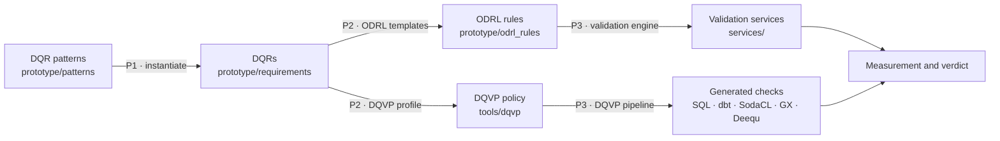

# Reference Catalog of Data Quality Requirement Patterns

The Reference catalog of Data Quality Requirement (DQR) Patterns is designed to support Data Space Governance Authorities in defining and managing data quality throughout the governance and operational processes underpinning their data spaces. It enables authorities to elicit DQRs by selecting and instantiating relevant patterns, thereby constructing a data space specific DQR catalog tailored to their governance and operational needs.

These patterns capture common and recurring DQRs encountered in data space data sharing and governance scenarios. For each pattern in the catalog, the associated data quality dimension, its identifier, a textual description of the requirement, the pattern template, an example of the pattern instantiation, and the corresponding automated validation service are explicitly defined.

| Quality Dimension | DQR Pattern Identifier | DQR Description | DQR Pattern | DQR Pattern Instantiation Example | Validation Service |
| ----------------- | ---------------------- | --------------- | ----------- | --------------------------------- | ------------------ |
| Currentness (ISO/IEC 25012) | DQRP1 | A specific data age is required for the values of an attribute of an entity | [DQRP1](https://github.com/feed-upc/DS-DataQualityRequirements/blob/main/media/DQRP1/DQRP1-Currentness.png) | The EHDS performs the [DQRP1 Instantiation](https://github.com/feed-upc/DS-DataQualityRequirements/blob/main/media/DQRP1/DQR7EHInstantiation.png) to define a DQR specifying that Patient Summary records are only valid if their data age does not exceed 1440 minutes. Its corresponding ODRL rule is [DQR7EH](https://github.com/feed-upc/DS-DataQualityRequirements/blob/main/prototype/odrl_rules/DQR7EH_odrl.json) | [policyChecker](https://github.com/feed-upc/DS-DataQualityRequirements/tree/main/services/policyChecker_05fb5861) |
| Completeness (ISO/IEC 25012) | DQRP2 | Values of an attribute must be mandatory | [DQRP2](https://github.com/feed-upc/DS-DataQualityRequirements/blob/main/media/DQRP2/DQRP2-Completeness.png) | The EHDS performs the [DQRP2 Instantiation](https://github.com/feed-upc/DS-DataQualityRequirements/blob/main/media/DQRP2/DQR1EHInstantiation.png) to define a DQR specifying that national healthcare patient ID shall be unambiguously used to identify patients and, therefore, it must not be a null value. Its corresponding ODRL rule is [DQR1EH](https://github.com/feed-upc/DS-DataQualityRequirements/blob/main/prototype/odrl_rules/DQR1EH_odrl.json) | [policyChecker](https://github.com/feed-upc/DS-DataQualityRequirements/tree/main/services/policyChecker_3ae130f1) |
| Compliance (ISO/IEC 25012) | DQRP3 | Values of an attribute must follow a specific format | [DQRP3](https://github.com/feed-upc/DS-DataQualityRequirements/blob/main/media/DQRP3/DQRP3-Compliance.png) | The EHDS performs the [DQRP3 Instantiation](https://github.com/feed-upc/DS-DataQualityRequirements/blob/main/media/DQRP3/DQR2EHInstantiation.png) to define a DQR specifying that patient affiliation countries must be referenced using country codes from the ISO 3166 International Standard. Its corresponding ODRL rule is [DQR2EH](https://github.com/feed-upc/DS-DataQualityRequirements/blob/main/prototype/odrl_rules/DQR2EH_odrl.json) | [policyChecker](https://github.com/feed-upc/DS-DataQualityRequirements/tree/main/services/policyChecker_5b132606) |
| Consistency (ISO/IEC 25012) | DQRP4 | Values of an attribute must be compatible with values of another attribute | [DQRP4](https://github.com/feed-upc/DS-DataQualityRequirements/blob/main/media/DQRP4/DQRP4-Consistency.png) | The EHDS performs the [DQRP4 Instantiation](https://github.com/feed-upc/DS-DataQualityRequirements/blob/main/media/DQRP4/DQR3EHInstantiation.png) to define a DQR specifying that male patients shall not have any recorded pregnancy history. Its corresponding ODRL rule is [DQR3EH](https://github.com/feed-upc/DS-DataQualityRequirements/blob/main/prototype/odrl_rules/DQR3EH_odrl.json) | [policyChecker](https://github.com/feed-upc/DS-DataQualityRequirements/tree/main/services/policyChecker_842a8b01) |
| Completeness (ISO/IEC 25012) | DQRP5 | A dataset must contain a minimum number of records | [DQRP5](https://github.com/feed-upc/DS-DataQualityRequirements/blob/main/media/DQRP5/DQRP5-Completeness.png) | The EHDS performs the [DQRP5 Instantiation](https://github.com/feed-upc/DS-DataQualityRequirements/blob/main/media/DQRP5/DQR4EHInstantiation.png) to define a DQR specifying that an AMR study must include at least 2000 bacterial isolates to ensure statistical reliability. Its corresponding ODRL rule is [DQR4EH](https://github.com/feed-upc/DS-DataQualityRequirements/blob/main/prototype/odrl_rules/DQR4EH_odrl.json) | [policyChecker](https://github.com/feed-upc/DS-DataQualityRequirements/tree/main/services/policyChecker_21a1ab80) |
| Fairness (Biessmann et al., 2021) | DQRP6 | An entity composition includes groups in appropriate proportions for the task and context | [DQRP6](https://github.com/feed-upc/DS-DataQualityRequirements/blob/main/media/DQRP6/DQRP6-Fairness.png) | The EHDS performs the [DQRP6 Instantiation](https://github.com/feed-upc/DS-DataQualityRequirements/blob/main/media/DQRP6/DQR5EHInstantiation.png) to define a DQR specifying that accurate estimation of antimicrobial resistance rates requires a study population with balanced representation of male and female patients for mitigating potential biases. Its corresponding ODRL rule is [DQR5EH](https://github.com/feed-upc/DS-DataQualityRequirements/blob/main/prototype/odrl_rules/DQR5EH_odrl.json) | [policyChecker](https://github.com/feed-upc/DS-DataQualityRequirements/tree/main/services/policyChecker_96133334) |

> Biessmann, F., Golebiowski, J., Rukat, T., Lange, D., Schmidt, P.: Automated data validation in machine learning systems. IEEE Data Eng. Bull. 44, 51–65 (2021)

## From requirement to validation

This repository covers the three processes of the framework. Each DQR keeps its identifier through every step, so a validation result can be traced back to the requirement and the pattern it instantiates.



| Process | What happens | Where |
| ------- | ------------ | ----- |
| P1 Specification | The governance authority selects a pattern and instantiates it with the parameters of its data space. The result is a DQR. | `prototype/patterns/`, `prototype/requirements/`, the prototype tool |
| P2 Operationalization | Each DQR becomes an ODRL rule through its pattern's template. DQRs that need constraints plain ODRL cannot state, such as row filters, reference standards, per-group counts or share gaps, are also expressed with DQVP, an ODRL profile for data quality. | `prototype/odrl_templates/`, `prototype/odrl_rules/`, `tools/dqvp/dqvp.ttl` |
| P3 Validation | The validation engine compiles each ODRL rule into a validation service that runs where the data is stored. The DQVP pipeline compiles a DQVP policy into checks for several engines and executes them. | `tools/validation-engine`, `services/`, `tools/dqvp/operationalization-pipeline/` |

The DQRs are kept only in this repository; the DQVP pipeline reads them from `prototype/requirements/`. A `dataspace.json` beside them tells the pipeline which data product each entity is stored in, and which column holds an attribute whose name differs in the data (for example `Hospital.country` is stored as `hospitalCountry`). The EHDS DQRs are in `prototype/requirements/`, and the HELEADE DQRs in `prototype/requirements/heleade/`. DQVP covers patterns DQRP2 to DQRP6; DQRP1 (currentness) is validated by the engine only.

The HELEADE DQRs show why the DQVP path exists. Their ODRL rules (`prototype/odrl_rules/heleade/`) are built from the same templates as the EHDS ones, but plain ODRL cannot carry three of them faithfully: DQR2HL checks a format (UTC), not a code list; DQR3HL requires values *not* in a set; and DQR4HL counts monitoring sites per wetland, not in total. Their services (`services/heleade/`) are therefore exported from the DQVP checks with `tools/dqvp/operationalization-pipeline/export_services.py`. Each service folder is named after its DQR, and its `service.json` records where it comes from.

### Running it

Clone with the submodules:

```bash
git clone --recurse-submodules git@github.com:feed-upc/DS-DataQualityRequirements.git
```

- **P1 and P2, interactively:** `streamlit run prototype/dqr_prototype2.py`.
- **P3 with the validation services:** `pytest tests`. The services need `great_expectations` 1.x. The end-to-end tests read the EHDS data from `../../DataProductLayer/DataProduct_EHDS_AMR/Data`, that is, from the [Fdatavalidation](https://github.com/feed-upc/Fdatavalidation) repository this catalogue is a submodule of. Tests that call the engine's API are skipped unless it is running.
- **P3 with DQVP:** from `tools/dqvp/operationalization-pipeline`, run `python dqr_to_dqvp.py` for the EHDS DQRs or `python dqr_to_dqvp.py ../../../prototype/requirements/heleade` for HELEADE. This needs the EYE reasoner and the packages listed in `tools/dqvp/README.md`. Its test of the live Great Expectations output expects `great_expectations` 0.18, so use a separate environment from the services.

## Repository Structure

- **`prototype/`** — Proof-of-concept tool for defining, instantiating, and operationalizing DQRs.
  - `patterns/` — DQR pattern definitions (DQRP1–6, JSON)
  - `requirements/` — Instantiated DQRs for the EHDS use case, and `dataspace.json` binding them to data products
  - `requirements/heleade/` — Instantiated DQRs for the HELEADE use case, with their `dataspace.json`
  - `odrl_rules/` — Generated ODRL policies, one per DQR instantiation (`heleade/` for the HELEADE use case)
  - `odrl_templates/` — ODRL generation templates, one per pattern
  - `dqr_prototype2.py` — Main application (`streamlit run prototype/dqr_prototype2.py`)
- **`media/`** — Auto-generated pattern diagrams and instantiation visualizations
- **`services/`** — Auto-generated validation services, one per DQR instantiation
  - `heleade/dqvp_policy.ttl` and `heleade/policy_checker.ttl` — the DQVP policy mapped from the HELEADE DQRs, and the policy checker compiled from it (one workflow per data product; each check's operations)
  - `heleade/<DQR>/` — HELEADE services generated from their DQVP checks: `validation_job.py`, the same check for dbt, SodaCL, Great Expectations and PyDeequ in `checks/`, and `service.json`, which records the DQR, its pattern, its ODRL rule, its DQVP check, and its workflow and operations in the policy checker
- **`tests/`** — Pattern instantiation, ODRL generation, the DQVP mapping, and execution of the services
- **`tools/validation-engine`** — Submodule: the [DataValidationWorkflow](https://github.com/feed-upc/DataValidationWorkflow) engine
- **`tools/dqvp`** — Submodule: [DQVP](https://github.com/feed-upc/DQVP-position), the ODRL data-quality profile and its pipeline

## Validation Engine

The validation services in `services/` are executed by the **DataValidationWorkflow** engine, available as a submodule under [`tools/validation-engine`](https://github.com/feed-upc/DataValidationWorkflow). The engine takes an ODRL policy as input, resolves the data and service catalog metadata, and deploys the corresponding validation service as an executable microservice.
